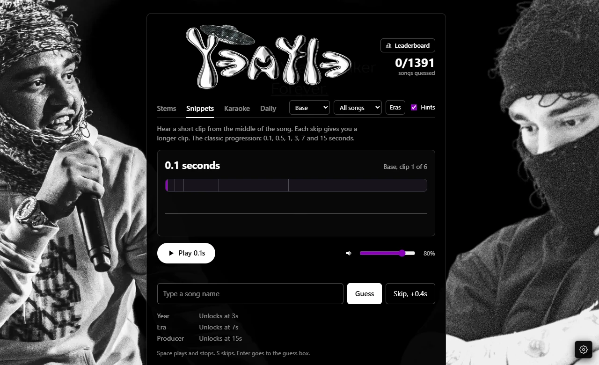

# Yeatle

Yeatle is a Yeat song guessing game with an online version, a desktop app, and a local browser server. Test your knowledge of released and unreleased tracks by guessing from isolated stems, filtered audio, short snippets, the shared Daily challenge, or Karaoke mode.



The original game was vibecoded by its creator in the [Yeat Hub Discord community](https://discord.gg/twizz). This repository preserves the game and adds desktop packaging, automated tests, and maintenance updates.

## Play or download

- **Play online:** open [Yeatle](https://playyeatle.duckdns.org/) in any browser. No downloads or setup required.
- **Desktop app:** download the build for your computer below. Node.js is bundled inside the app.
- **Local browser server:** [download the repository ZIP](https://github.com/gustownis/yeatle/archive/refs/heads/main.zip) or clone it, install [Node.js 24 LTS](https://nodejs.org/en/download), and run `node server.js` (no `npm install` needed).

### Desktop downloads (v1.15)

| Computer | Downloads |
| --- | --- |
| Windows, Intel/AMD (x64) | [Installer](https://github.com/gustownis/yeatle/releases/download/v1.15.0/Yeatle-Setup-1.15.0-windows-x64.exe) · [Portable](https://github.com/gustownis/yeatle/releases/download/v1.15.0/Yeatle-1.15.0-windows-x64-portable.exe) |
| macOS, Apple Silicon (ARM64) | [DMG](https://github.com/gustownis/yeatle/releases/download/v1.15.0/Yeatle-1.15.0-mac-arm64.dmg) · [ZIP](https://github.com/gustownis/yeatle/releases/download/v1.15.0/Yeatle-1.15.0-mac-arm64.zip) |
| macOS, Intel (x64) | [DMG](https://github.com/gustownis/yeatle/releases/download/v1.15.0/Yeatle-1.15.0-mac-x64.dmg) · [ZIP](https://github.com/gustownis/yeatle/releases/download/v1.15.0/Yeatle-1.15.0-mac-x64.zip) |
| Linux, Intel/AMD (x64) | [AppImage](https://github.com/gustownis/yeatle/releases/download/v1.15.0/Yeatle-1.15.0-linux-x64.AppImage) · [DEB](https://github.com/gustownis/yeatle/releases/download/v1.15.0/Yeatle-1.15.0-linux-x64.deb) |
| Linux, ARM64 | [AppImage](https://github.com/gustownis/yeatle/releases/download/v1.15.0/Yeatle-1.15.0-linux-arm64.AppImage) · [DEB](https://github.com/gustownis/yeatle/releases/download/v1.15.0/Yeatle-1.15.0-linux-arm64.deb) |

Checksums for all downloads are in [SHA256SUMS.txt](https://github.com/gustownis/yeatle/releases/download/v1.15.0/SHA256SUMS.txt). Desktop apps check for newer releases on launch and through **Settings → Desktop App → Check for Updates**.

### Quick start (local browser version)

1. Extract the downloaded ZIP into a writable folder (keep `server.js`, `server/`, `data/`, and `build/` together) or run `git clone https://github.com/gustownis/yeatle.git`.
2. Make sure [Node.js 24 LTS](https://nodejs.org/en/download) or newer is installed (`node --version`).
3. Start the server using your OS launcher or `node server.js`, then open `http://127.0.0.1:3093`.

<details>
<summary>Quick launch commands by OS</summary>

- **Windows:** double-click `Start Yeatle (Node).bat`, or run `node server.js` in PowerShell from the extracted folder.
- **macOS:** run `chmod +x "Start Yeatle.command"` and open it in Finder, or run `node server.js` in Terminal.
- **Linux:** run `sh ./start-yeatle.sh` or `node server.js` in a terminal.

</details>

Do not open `build/index.html` directly from disk; the local server provides the song list, audio routes, AI models, and browser headers required for audio separation.

## Game modes

Pick which eras and song pools you want (**All songs**, **Released**, **Unreleased**, or **Stems only**), then choose a mode. Yeat vocal features are included, while producer-only credits and non-vocal tracks are filtered out.

- **Stems (`/` or `/?mode=stems`):** reveals **drums → bass → other instruments → song info → vocals**. Uses local HQ stems when installed, or separates audio in your browser with the built-in ONNX Spleeter model. **Light** mode uses filtered audio instead of AI separation.
- **Snippets (`/?mode=snippet`):** reveals short audio clips across four difficulty levels, with three free skips per ten songs when audio is missing or unhelpful.
- **Daily (`/daily`):** one shared song each day, synchronized across clients and resetting at 12:00 AM EST/EDT (6:00 AM CET/CEST).
- **Karaoke (`/karaoke`):** sing along with up to four microphones using notes built from vocal stems and synced lyrics from [lrclib.net](https://lrclib.net) or [lyrics.ovh](https://lyrics.ovh). Includes **White people mode** to skip sensitive lyrics automatically without scoring penalties.

## Documentation

- [Setup, updates, and troubleshooting](docs/setup.md) — OS install notes (including unsigned app prompts), AI model downloads, Karaoke mic calibration, and common fixes.
- [Optional HQ stems](docs/stems.md) — downloading verified stem packs inside the desktop app or manually from MEGA, plus folder structure and metadata.
- [Configuration and admin panel](docs/configuration.md) — `config.json` options, hosting settings, `admin.json`, player management, and network privacy.
- [Development and desktop builds](docs/development.md) — running tests, smoke checks, packaging installers, publishing releases, and notes on the incomplete `source/` folder.
- [Public API](docs/api.md) — read-only `/api/v1` endpoints for leaderboards and Daily status.
- [Catalog and answer policy](docs/catalog-answer-policy.md) — how song versions, credits, exclusions, linked answers, and pre-masters work.

## Project layout

```text
yeatle/
├── server.js                 Browser and desktop server entry point
├── server/                   Backend modules (catalog, cache, daily, leaderboards)
├── data/                     Tracked catalog metadata, era covers, and song curation
├── desktop/                  Electron shell, menus, auto-updater, and stem downloader
├── build/                    Playable frontend and ONNX Runtime Web assets
│   └── Songs/                Optional local HQ stems (gitignored)
├── docs/                     Guides, API reference, release notes, and QA archives
├── licenses/                 Third-party notices and license texts
├── scripts/                  Packaging, release prep, curation merge, and smoke tools
├── tests/                    Automated Node test suite and fixtures
├── source/                   Incomplete imported Vite project (missing src/)
├── config.example.json       Template for local config.json
├── Start Yeatle (Node).bat   Windows launcher
├── Start Yeatle.command      macOS launcher
└── start-yeatle.sh           Linux launcher
```

## Community, license, and credits

Report song issues or share feedback in the Yeatle channel on the [Yeat Hub Discord](https://discord.gg/twizz).

Original Yeatle code is released under the [Unlicense](LICENSE). Third-party libraries, models, borrowed code, and media attributions are documented in [licenses/THIRD_PARTY_NOTICES.md](licenses/THIRD_PARTY_NOTICES.md).

- **Original game:** vibecoded by the original creator from the Yeat Hub Discord community.
- **Audio separation:** [Spleeter by Deezer Research](https://github.com/deezer/spleeter), [Best-Practice ONNX conversion](https://huggingface.co/Best-Practice/spleeter-4stems-onnx), and [ONNX Runtime Web](https://github.com/microsoft/onnxruntime).
- **App shell:** React, Vite, Electron, and `electron-updater`.

Yeatle is an unofficial fan project with no affiliation or endorsement from Yeat, Apple, Deezer, or other referenced services.
