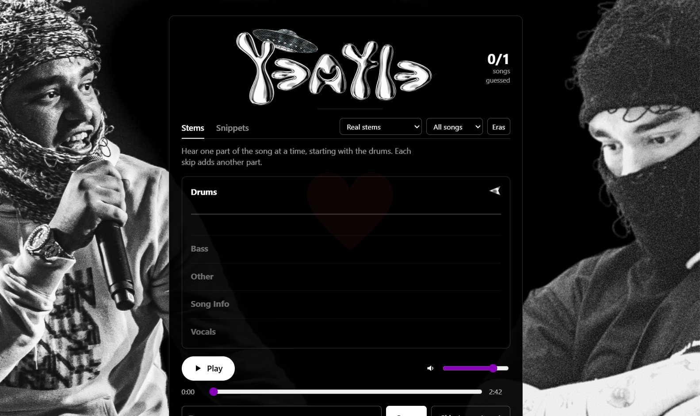

# Yeatle

Yeatle is a Yeat song guessing game with online, desktop, and local browser versions. Test your knowledge of released and unreleased tracks, choose the eras you want to play, and guess songs from isolated stems, filtered audio, or short snippets.



**The original Yeatle application was vibecoded in its entirety**: it was
created through AI-assisted coding by the original creator from the
[Yeat Hub Discord community](https://discord.gg/twizz). This repository
preserves that game and adds desktop packaging, setup documentation, and
maintenance improvements. Third-party libraries and models are credited
separately below.

The desktop app and downloaded browser version run on your computer. The desktop app opens the game in its own window and includes an **Open in Browser** menu option.

The desktop app checks for updates on launch. Use **Help → Check for Updates** to check again, or **Developer → Open Admin Panel** to manage songs. Developer tools live in the **Developer** menu.

## Downloads

- **Play online:** [open Yeatle](https://playyeatle.duckdns.org/) on any device with a browser. No downloads, installation, or Node.js required.
- **Desktop app:** choose your computer in the table below. Everything needed
  to run the app is included; you do not need to install Node.js.
- **Local browser version:** [download Yeatle as a ZIP](https://github.com/gustownis/yeatle/archive/refs/heads/main.zip),
  install [Node.js LTS](https://nodejs.org/en/download), then follow the
  [browser setup instructions](#download-the-browser-version).
- **Optional higher-quality stems:** [download from MEGA](https://mega.nz/folder/Kkh3WIyQ#xnMG5aidP0AGWQas0bur4g)
  and follow the [stem setup instructions](#optional-hq-stems).

You can play without the optional stems. The built-in audio separation files download automatically when Real stems mode prepares the AI worker.

### Choose your desktop download

| Computer | Downloads |
| --- | --- |
| Windows, Intel/AMD (x64) | [Installer](https://github.com/gustownis/yeatle/releases/download/v1.9.5/Yeatle-Setup-1.9.5-windows-x64.exe) · [Portable app](https://github.com/gustownis/yeatle/releases/download/v1.9.5/Yeatle-1.9.5-windows-x64-portable.exe) |
| Mac, Apple Silicon (ARM64) | [DMG](https://github.com/gustownis/yeatle/releases/download/v1.9.5/Yeatle-1.9.5-mac-arm64.dmg) · [ZIP](https://github.com/gustownis/yeatle/releases/download/v1.9.5/Yeatle-1.9.5-mac-arm64.zip) |
| Mac, Intel (x64) | [DMG](https://github.com/gustownis/yeatle/releases/download/v1.9.5/Yeatle-1.9.5-mac-x64.dmg) · [ZIP](https://github.com/gustownis/yeatle/releases/download/v1.9.5/Yeatle-1.9.5-mac-x64.zip) |
| Linux, Intel/AMD (x64) | [AppImage](https://github.com/gustownis/yeatle/releases/download/v1.9.5/Yeatle-1.9.5-linux-x64.AppImage) · [DEB](https://github.com/gustownis/yeatle/releases/download/v1.9.5/Yeatle-1.9.5-linux-x64.deb) |
| Linux, ARM64 | [AppImage](https://github.com/gustownis/yeatle/releases/download/v1.9.5/Yeatle-1.9.5-linux-arm64.AppImage) · [DEB](https://github.com/gustownis/yeatle/releases/download/v1.9.5/Yeatle-1.9.5-linux-arm64.deb) |

Installation steps for each OS are below.
[SHA-256 checksums](https://github.com/gustownis/yeatle/releases/download/v1.9.5/SHA256SUMS.txt)
are provided with the release.

## Requirements

- **Online:** a browser and an internet connection. No app installation needed.
- **Desktop:** a current Windows, macOS, or desktop Linux installation supported
  by the bundled Electron runtime. Choose a download matching your CPU.
- **Local browser version:** Node.js **24 LTS or a newer supported LTS**, plus a current
  browser. Chrome or Edge is a useful starting point for troubleshooting the
  supplied ONNX/WebAssembly runtime. Other browsers may behave differently.
- **Internet:** needed to read the tracker, stream remote audio, fetch artwork,
  and download models. A saved song list and local stems can work when those
  services are unavailable; remote audio still requires access to its host.
- **Storage:** roughly 80 MB for the four downloaded models, plus the app and
  any optional HQ stems. The separate stem pack may require substantially more.
- **Performance:** automatic stem separation uses your computer's resources.
  Processing time and quality depend on the hardware and source audio. Local
  HQ stems and filtered playback avoid that separation work.

The local browser server uses built-in Node.js modules. **You do not need `npm install` to play locally.** Desktop development/building requires npm packages.

## Download the browser version

These steps are for running the browser version locally on your own computer.

1. [Download the browser version ZIP](https://github.com/gustownis/yeatle/archive/refs/heads/main.zip).
2. Extract the entire ZIP into a writable folder, such as Downloads or Documents.
3. Open the extracted folder containing `server.js`, `build/`, and this README,
   then follow the Windows, macOS, or Linux browser instructions below.

Keep the folders together. Do not run `server.js` inside the ZIP, move it away
from `build/`, or open `build/index.html` directly. The local server supplies
the song list, audio routes, models, and browser headers the game needs.

If you prefer Git, [install it here](https://git-scm.com/downloads) and run:

```sh
git clone https://github.com/gustownis/yeatle.git
cd yeatle
```

Cloning this public repository does not require authentication.

## Windows

### Desktop app

1. Download the Windows **x64 installer** (`Yeatle-Setup-1.9.5-windows-x64.exe`) for a usual
   Intel/AMD Windows PC, or the matching portable `.exe` if offered.
2. Run the installer, choose the installation folder if prompted, and open
   **Yeatle** from Start. The portable app runs directly without installation.
3. On first launch, allow time for the song list. Real stems mode prepares the AI worker and downloads models if needed. Light and Snippets avoid AI preparation.

Node.js is bundled with the desktop app. Do not install it just to run the app.
These community builds are unsigned and may show an OS reputation
warning. Verify that the file came from this project's release or build page.
If your organization blocks unsigned software, use the browser version.

### Browser version

1. Open the [Node.js download page](https://nodejs.org/en/download).
2. Select the current **LTS** release and Windows. Choose **x64** for most
   Intel/AMD PCs or **ARM64** for an ARM Windows device.
3. Download and run the `.msi` installer. Keep the option to add Node.js to PATH.
4. Close and reopen your terminal after installation.
5. Extract Yeatle as described above, then double-click **Start Yeatle (Node).bat**.
6. Your browser opens at **http://127.0.0.1:3093**. Keep the terminal window open.

You can also start it manually from PowerShell:

```powershell
cd "C:\Users\YOUR_NAME\Downloads\yeatle-main"
node --version
node server.js
```

Replace the example folder with the actual extracted folder. Close the running
terminal or press **Ctrl+C** to stop the browser server.

## macOS

### Desktop app

1. Download the **ARM64** build for Apple Silicon (M-series Macs), or the **x64**
   build for an Intel Mac. **Apple menu → About This Mac** shows which you have.
2. Open the `.dmg` and drag **Yeatle** into Applications. If using a `.zip`,
   extract it and move **Yeatle.app** into Applications.
3. Open Yeatle and let its initial downloads finish.

The current build configuration does not sign or notarize the app. If macOS
blocks it, use the browser version or a future signed release. Node.js is
bundled with the desktop app.

### Browser version

1. Install Node.js LTS using the **macOS `.pkg` installer** from the
   [official download page](https://nodejs.org/en/download).
2. Extract Yeatle, then open Terminal.
3. Change to the extracted folder and run:

```sh
cd "$HOME/Downloads/yeatle-main"
node --version
node server.js
```

Alternatively, make the supplied launcher executable and open it in Finder:

```sh
chmod +x "Start Yeatle.command"
```

The game opens at **http://127.0.0.1:3093**. Keep Terminal open while playing;
press **Ctrl+C** to stop the server. Adjust the example path if you extracted
the project somewhere else.

## Linux

### Desktop app

Choose **x64** for an Intel/AMD computer or **ARM64** for a supported ARM device.
Run `uname -m` if unsure: `x86_64` means x64, and `aarch64` means ARM64.

For an AppImage, open a terminal in its download folder:

```sh
chmod +x Yeatle-*.AppImage
./Yeatle-*.AppImage
```

If multiple files match, use the full filename of the matching architecture.
Some distributions require FUSE support to run AppImages. If unavailable,
use the matching `.deb` on Debian/Ubuntu or the browser version.

For a Debian/Ubuntu package, install the exact downloaded filename:

```sh
sudo apt install ./Yeatle-1.9.5-linux-x64.deb
```

For ARM64, use the package ending in `-arm64.deb`. Open Yeatle from your desktop
application menu. Node.js is bundled in both desktop formats.

### Browser version

Install a supported Node.js LTS using your distribution's package manager or
the [official Node.js download instructions](https://nodejs.org/en/download).
Distribution repositories can offer an older version; check `node --version`
before continuing. Version 24 LTS is the recommended baseline for this project.

If you use the official standalone Linux binary instead:

1. Download the LTS `.tar.xz` for your architecture from the Node.js page.
2. Extract it into a folder you own, such as `$HOME/.local/lib`.
3. Add that extracted folder's `bin/` to your PATH. Replace the example below
   with the version and architecture you actually downloaded:

```sh
mkdir -p "$HOME/.local/lib"
tar -xJf "$HOME/Downloads/node-v24.VERSION-linux-x64.tar.xz" -C "$HOME/.local/lib"
export PATH="$HOME/.local/lib/node-v24.VERSION-linux-x64/bin:$PATH"
node --version
```

The `export` applies to the current terminal. To keep it for later sessions,
add the corrected line to your shell's startup file (for example `~/.bashrc`).
`VERSION` is a placeholder; do not run those commands without replacing it.

Then extract Yeatle, open its folder in a terminal, and run:

```sh
cd "$HOME/Downloads/yeatle-main"
sh ./start-yeatle.sh
```

Or simply run `node server.js`. If no browser opens automatically, visit
**http://127.0.0.1:3093** yourself. The automatic opener uses `xdg-open`;
manual opening works when that utility is absent. Press **Ctrl+C** to stop.

## How to play

Choose which eras and song categories you want, then select a game mode.
The tracker supplies released and unreleased songs; available links can vary.

### Stems and filtered audio

Stem mode gradually reveals **drums → bass → other instruments → song
information → vocals**. HQ local stems give the clearest separation. Otherwise,
the built-in Spleeter ONNX model separates audio on your computer as you play.
Automatic separation quality varies and is generally less reliable than a
good prepared stem pack.

The lightweight filtered option reveals a low-end version, then muffled audio,
with further clues as the round progresses. The game can also use filters when
automatic separation fails. Released songs with no full accessible audio may
use an Apple preview of approximately 30 seconds.

### Snippets

Snippet mode reveals short portions of the song. The original game offers
four difficulty choices. It also includes a limited free-skip mechanic for
rounds with missing audio or unhelpful beat-only snippets: three free skips
per ten songs when the game's conditions are met, without a streak/stat penalty.

You can enable or disable eras and filter for released or unreleased songs.
The original game also includes completion surprises.

The 1.9 tracker overhaul added more era categories. When playing **Released**
or **Unreleased** rather than **All songs**, select every era associated with
the album you want. For example, include **Lyfestyle [V2]**, **LYFESTYLE**, and
**LYFESTYLE DIGITAL DELUXE** to cover the associated Lyfestyle categories.

The original creator's 1.9 notes report that both **Kranky** tracks in the
**Super Geeky** era now work. One is labeled `Kranky *Tanky` to distinguish
the versions with different runtimes.

## Optional HQ stems

Open the [separate MEGA folder](https://mega.nz/folder/Kkh3WIyQ#xnMG5aidP0AGWQas0bur4g),
download the songs you want, and extract them. Keep **one folder per song**;
do not put a second `Songs` directory inside the destination `Songs` directory.

- **Browser version:** place song folders inside `build/Songs/` in the extracted
  Yeatle project.
- **Desktop app:** select **Game → Open Songs Folder** and place them there.
  This folder is outside the installed app so updates preserve it.

Use this layout with **lowercase filenames**, especially on Linux:

```text
Songs/
└── Lyfe Stealer/
    ├── drums.mp3
    ├── bass.mp3
    ├── other.mp3
    ├── vocals.mp3
    └── info.txt          (optional)
```

Some older packs use `Drums.mp3`, `Bass.mp3`, `Other.mp3`, and `Vocals.mp3`.
Rename them to the lowercase names above for compatibility with case-sensitive
filesystems. All four files are required for the folder to be recognized.

The folder name is matched to tracker titles with accent/punctuation
normalization. Optional `info.txt` metadata can help distinguish duplicate
titles:

```text
Album: Lyfë
Year: 2022
Producer(s): Example producer
```

Restart Yeatle after adding files, or refresh the song list. Song stems are not
stored in Git or bundled in desktop installers. Hosting them separately does
not change any copyright or download terms attached to the audio.

## Performance on phones

Version 1.9.5 automatically uses a smaller audio cache on phones and low-memory devices, skips next-song AI preloading, and draws waveforms at about 30 FPS. The current round stays protected, and audio quality, snippet timing, and the final-level playback fix are preserved. The next AI song may take longer to become ready because it is loaded when you need it.

The cache uses a 128 MiB soft budget on these devices and 384 MiB on other computers. An active song may exceed its budget; AI separation still needs substantial memory. Desktop preloading remains available when the budget permits.

Unchanged game files, including the large WebAssembly runtime, can be reused after a quick server validation. New file contents and app releases change their validators, so updates still load correctly.

The server caches compressed code and WebAssembly downloads within a 32 MiB budget and compresses each prepared song list once. Audio and byte-range playback keep their existing behavior. Tracker, admin, and optional song-photo edits still invalidate prepared responses immediately. Admin song changes use an event stream, which closes while the tab is hidden and reconnects with the latest selection. Installations without admin control skip these checks; older servers and browsers can still use polling.

The AI repair restores the 1.9.3 model-loading behavior and prepares models when Real stems is selected. The standalone worker keeps its original GPU correctness check. Brief listener detachment no longer cancels an unfinished job; explicit cache eviction and switching to Light or Snippets still cancel unused jobs. If AI fails, the game shows its reason and selects Light in the dropdown. Selecting Real stems retries without changing the saved AI preference or round. Phone and tablet identities hide the keyboard hint; narrow windows and touch on a desktop keep it visible.

Version 1.9.5 releases idle AI sessions after one minute, dismantle retired audio graphs, and stop unfinished separation when the final level switches to the original song. Rolling worker buffers and reused calculations preserve the original sample results and snippet timing. Completed stems can also survive reloads in a lossless browser cache, capped at 192 MiB total and 100 MiB per song. The cache checks the audio content, model content, algorithm, sample rate, and browser identity; unavailable storage or an invalid entry simply causes normal separation. Privacy settings that alter audio-buffer reads, as observed in Brave, disable this optional persistent cache so it cannot alter live samples. Model warmup remains available even on a stem-cache hit. Measurements and validation are in [docs/local-optimization-results.md](docs/local-optimization-results.md) and the [physical Android test](docs/android-ai-test.md).

The admin song list shows 100 songs per page, keeps selections across pages, and waits briefly between search keystrokes. **Select all matches** selects every song matching the current filters. The desktop admin window opens without the game menu bar.

For a hosted update, update the full project and restart the server. Include `static-cache.cjs`, `live-control.cjs`, and all files in `build/assets/`, including `performance.mjs` and `stem-cache.mjs`. The AI worker is standalone and no longer imports `model-download.mjs` or `worker-lifecycle.mjs`. Asset queries distinguish the local changes from cached 1.9.5 scripts. The separately hosted online version gets these changes when its operator deploys the update.

## Models and first launch

When Real stems prepares the AI worker, the server downloads these four files into its `models/` data folder if they are missing:

- `drums.fp16.onnx`
- `bass.fp16.onnx`
- `other.fp16.onnx`
- `vocals.fp16.onnx`

Each is roughly 19.7 MB. They come from
[Best-Practice/spleeter-4stems-onnx](https://huggingface.co/Best-Practice/spleeter-4stems-onnx)
and are reused on later launches. Interrupted downloads are discarded rather
than saved as complete models. Restart to retry after fixing a connection issue.

For manual installation, download those exact `.fp16.onnx` files from the
upstream files page and place them in `models/` next to `server.js` for browser
play, or in the desktop data folder's `models/` directory. Do not substitute
the larger `.onnx` files or rename a ZIP/archive to `.onnx`.

There is no need to install Python, TensorFlow, a separate Spleeter program,
or GPU drivers solely for this setup. The supplied game uses ONNX Runtime Web.

## Updating the desktop app

Yeatle 1.9.1 and later check this project's GitHub releases about ten seconds after
launch. It only offers newer regular releases, skipping drafts and prereleases.
You can also select **Help → Check for Updates** at any time.

1. When a new version is found, choose **Download Update** or **Release Notes**.
   You can choose **Later** and keep playing.
2. The app downloads the correct file for your computer and verifies its
   checksum. A broken download will not be installed.
3. Finish the update according to your installation:

| Your installation | How the update finishes |
| --- | --- |
| Windows installer | Choose **Install and Restart**. Yeatle closes, installs the update in the existing folder, and restarts. |
| Linux AppImage | Choose **Install and Restart**. Yeatle replaces the AppImage and restarts. Its folder must be writable. |
| Mac | Choose **Open Installer**, quit Yeatle, and replace the app in Applications. These unsigned builds cannot use macOS's automatic updater. |
| Windows portable | Choose **Show Download**, close Yeatle, and replace your old portable executable with the new one. |
| Linux DEB | Choose **Open Installer**, quit Yeatle, and finish installation in your system's package installer. |

The app does not install updates in the background or replace your settings,
admin password, downloaded models, or stems. Game progress stays in the same
desktop profile. If GitHub or your connection is unavailable, you can keep
playing and try again later.

**Upgrading from 1.9.0:** download and install 1.9.5 once using the links above.
The updater is available from 1.9.1 onward. The browser version has no desktop
menu or installer updater; download the new browser ZIP or update your Git
checkout, keeping your local settings and song folders.

## Settings, saved files, and privacy

For browser play, settings and server caches live beside `server.js`. To
customize settings, copy `config.example.json` to `config.json`, edit it in a
text editor, and restart. For example:

```json
{
  "port": 3093,
  "desktopPort": 3094,
  "openBrowser": true,
  "refreshMinutes": 30,
  "artist": "Yeat",
  "sheetId": "1FUzAZyTCgFTVxQ--qbCAS2bUk4dsAw6ASxwjURPHbyI",
  "tabs": [
    { "name": "Released", "gid": "1617341558" },
    { "name": "Unreleased", "gid": "1241081326" }
  ],
  "googleApiKey": ""
}
```

| Setting | Purpose |
| --- | --- |
| `port` | Browser server port; default 3093 |
| `desktopPort` | Desktop local server port; default 3094 |
| `openBrowser` | Open your browser automatically in browser mode; ignored by desktop mode |
| `refreshMinutes` | Tracker refresh interval; 0 disables periodic refresh |
| `artist` | Artist used for preview searches |
| `sheetId`, `tabs` | Google tracker sheet and tab identifiers |
| `googleApiKey` | Optional key for sheets with links hidden behind display text; keep it private |

The desktop app creates its own settings on first launch. Select **Game →
Open Settings and Logs Folder** to find them. Typical locations are:

| OS | Desktop data directory |
| --- | --- |
| Windows | `%APPDATA%\Yeatle` |
| macOS | `~/Library/Application Support/Yeatle` |
| Linux | `${XDG_CONFIG_HOME:-~/.config}/Yeatle` |

The menu shows the actual folder used by your installation. `desktop.log`
records server output for troubleshooting. Models, local stems, and settings
remain in this directory when the app's installation files are replaced.

Game statistics and preferences are stored in the game window/browser's local
storage. Desktop and external browsers have separate storage. Use the same
browser profile and port to keep browser progress; changing the port creates a
different local origin. The desktop port remains stable between launches.

The server listens only on **127.0.0.1**. Outbound requests go to the configured
Google tracker, song hosts, Apple services, artwork hosts, and Hugging Face.
Automatic separation runs locally. The app does not include a separate
project analytics service. Third-party services have their own policies.

### Optional admin panel

The original browser package provides its admin panel at
**http://localhost:3093/admin**, with the password **`garlic`** (all lowercase).

**Desktop 1.9.1 and later:** select **Developer → Open Admin Panel**. A new installation
uses `garlic`; an existing custom password is preserved. The panel opens in a
separate window so your game stays open.

**Browser version:** enable the panel by creating an `admin.json` next to
`server.js` and restarting. To use the same password:

```json
{ "password": "garlic" }
```

For browser mode, open `http://127.0.0.1:3093/admin`; for desktop mode, use
`http://127.0.0.1:3094/admin` in a browser (adjust if you changed the port).
The server replaces the plaintext password with a salted hash on startup.
Never share `admin.json`. The original imported credential file is excluded
from the repository and desktop packages.

You can choose another password in `admin.json` if you prefer. It lets you
correct song names, eras, and other minor metadata issues while waiting for
an upstream update.

## Troubleshooting

| Problem | What to do |
| --- | --- |
| `node` is not recognized / command not found | Install Node.js LTS, reopen the terminal, and check `node --version`. Ensure its `bin` directory is in PATH. |
| Windows says `npm.ps1` cannot run | Use `npm.cmd` instead of `npm` for desktop development commands in PowerShell. Browser play only needs `node server.js`. |
| A launcher closes or stops with an error | Run `node server.js` in a terminal to read the message. Check your settings and folder permissions. |
| Port is already in use | Close the other running copy or edit `port`/`desktopPort` in the appropriate `config.json`. Changing ports affects saved game storage. |
| Invalid settings / JSON syntax error | Use double quotes, omit trailing commas, and compare with `config.example.json`. |
| Browser does not open | Visit the printed local address yourself. Keep the server running. |
| Blank page after an update | Refresh the page, verify `build/index.html`, `build/assets/`, and `build/ort/` are present, and inspect the browser console if needed. |
| Tracker cannot be reached | Check the network and sheet settings. The server uses a previously saved list if available; on a fresh offline setup only local stem songs can be listed. |
| A song will not play | The host may be down, the link may be dead, or a preview may be unavailable. Try another song or install local stems. |
| Model download fails | Check access to Hugging Face and free disk space, then restart. For a corrupt completed model, remove that specific `.fp16.onnx` file to redownload it. |
| Separation is slow or sounds poor | Try local HQ stems, filtered playback, or snippets. Close other resource-heavy applications. |
| Stem folders are missing from the game | Check the destination, avoid nested `Songs/Songs/`, and verify all four lowercase `.mp3` filenames. Restart/refresh. |
| Desktop app cannot start | Read its error dialog and `desktop.log` in the data folder. Check `desktopPort` and JSON syntax. |
| `npm run build` fails in `source/` | The original React source is missing; see the development note below. It is not needed to run or package the supplied game. |

## Development and desktop builds

Install Node.js 24 LTS, download/clone the repository, and open a terminal in
the **root folder containing this README and `package.json`**:

```sh
npm ci
npm test
npm run desktop
```

On Windows PowerShell, use `npm.cmd` if script execution policy blocks `npm`.
`npm ci` installs the versions recorded in `package-lock.json`; the Electron
binary downloads as needed. Leave the original frontend's `source/` project
alone unless you have restored its missing code.

Build on the matching operating system:

```sh
npm run dist:win -- --x64
npm run dist:mac -- --arm64
npm run dist:mac -- --x64
npm run dist:linux -- --x64
npm run dist:linux -- --arm64
```

Windows builds produce an installer and a portable executable. macOS builds
produce DMG/ZIP files; Linux builds produce AppImage/DEB files. Outputs appear
in `release/`, which is excluded from Git. `npm run pack` creates an unpacked
desktop build for local verification. These builds are unsigned; signing and
macOS notarization require separate maintainer credentials/configuration.

In GitHub, **Actions → Desktop builds → Run workflow** builds Windows x64,
macOS Apple Silicon/Intel, and Linux x64/ARM64. Download the matching artifact
from the finished run and extract the artifact ZIP to find the installer.
Artifacts expire after 14 days. This workflow does not publish a release
automatically. Maintainers can attach reviewed installers to a GitHub Release.

The **Checks** workflow tests the server on Windows, macOS, and Linux.
Tests cover compiled assets, WebAssembly headers, separate stem storage,
cached lists, admin login, invalid configuration, interrupted model downloads,
release selection, update integrity, the desktop menu, and final-level
AI-split playback without restarts when new chunks arrive, exact separation output across chunk boundaries, final-level cancellation, cache validation, compressed downloads, live song updates, protected active-song memory, model loading, skipped-song cancellation, AI startup cleanup, and phone waveform frame limits. Local browser verification also exercises real-song separation, lossless persistent stems, disabled storage, idle-worker reinitialization, snippet timing, and synchronized hand-made stems.

### Publishing updates

After all five desktop builds finish, download their artifacts into a folder
and prepare the checksums and updater metadata:

```sh
npm run prepare:release -- 1.9.5 release/github-builds-1.9.5 release/update-metadata-1.9.5
```

For a future release, replace `1.9.5` in the version and folder names. The script
requires all ten installers/archive files and fails if any are missing. It
copies them into the output folder with consistent download names, including
normalizing Linux's `amd64`/`x86_64` names to `x64`. Attach all fourteen files
from that output folder (ten downloads, checksums, and three updater feeds)
to a draft GitHub Release. Verify all uploads before
publishing it as a regular **Latest** release. The metadata must match the
installer bytes; rerun the script if you rebuild anything. Do not rename the
installer files after generating metadata.

### Original frontend source is incomplete

The imported folder contains compiled React assets and the original Vite
configuration, but **the `source/src/` directory, including `main.jsx`, was
not supplied**. There are no supplied source maps. This repository therefore
supports editing the server and desktop integration and packaging the existing
game; it does not claim a reproducible React frontend build.

Request the original `src/` and `public/` directories from the creator to
restore normal frontend development. See [source/README.md](source/README.md)
for the subsequent build steps. Desktop packaging uses the supplied `build/`
files and does not require Vite to run.

## Project layout

```text
yeatle/
├── server.js                 Local tracker/audio/game server
├── static-cache.cjs          Static-file validation and bounded gzip cache
├── live-control.cjs          Admin song event stream
├── desktop/main.cjs          Desktop window and server lifecycle
├── build/                    Supplied playable frontend and runtime assets
│   └── Songs/                Optional local stems (excluded from Git)
├── source/                   Original, incomplete Vite project
├── config.example.json       Shareable default settings
├── config.json               Your browser settings (optional; excluded)
├── models/                   Browser-mode model downloads (excluded)
├── tests/                    Server/download checks
├── licenses/                 Third-party runtime license texts
└── .github/workflows/        Checks and manual desktop builds
```

The imported `Yeatle 1.9 + Mac/` folder, if present on the maintainer's machine,
is a preserved local original and is not part of the published repository.

## Feedback and community

Yeatle originated in the [Yeat Hub Discord community](https://discord.gg/twizz).
Please report remaining song or playback issues, suggest additions, and share
ideas for improvements in the server's Yeatle feedback channel.

The original creator describes development as an enjoyable but challenging
process and appreciates everyone who plays the game and shares feedback.
Your reports help improve future updates.

## License and credits

Original Yeatle project code is released under the **Unlicense**. You may use,
copy, modify, and redistribute that code, including commercially, without a
project attribution requirement. It is provided as-is, without warranties.
See [LICENSE](LICENSE) and the [Unlicense reference](https://unlicense.org/).

This does not relicense third-party code, models, music, artwork, or videos.
Read [THIRD_PARTY_NOTICES.md](THIRD_PARTY_NOTICES.md) for retained attributions,
licenses, and the original server's `tracker-player` provenance note.

- Original game: created entirely through vibecoding by the original creator from the [Yeat Hub Discord community](https://discord.gg/twizz).
- Separation: [Spleeter by Deezer Research](https://github.com/deezer/spleeter).
- ONNX conversion: [Best-Practice / madewith-bestpractice](https://huggingface.co/Best-Practice/spleeter-4stems-onnx).
- Browser inference: [ONNX Runtime Web](https://github.com/microsoft/onnxruntime).
- Frontend: React and Vite; desktop shell: Electron and electron-builder.

Yeatle is an unofficial fan project. Artist names and referenced media remain
subject to their respective rights; no affiliation or endorsement is claimed.
